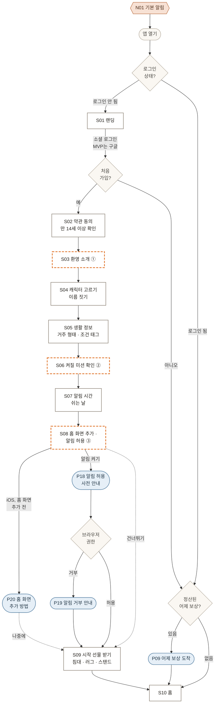
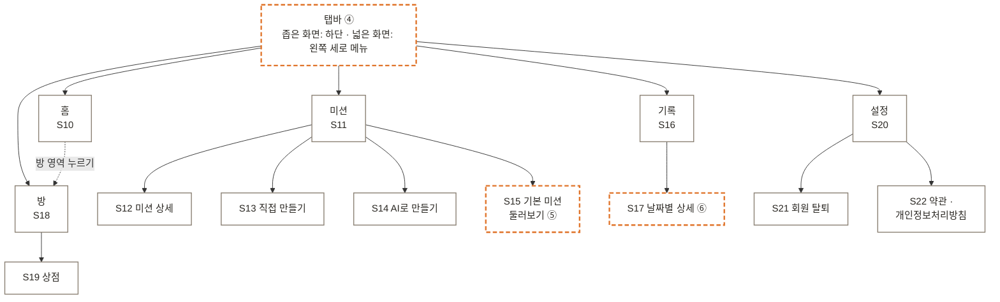
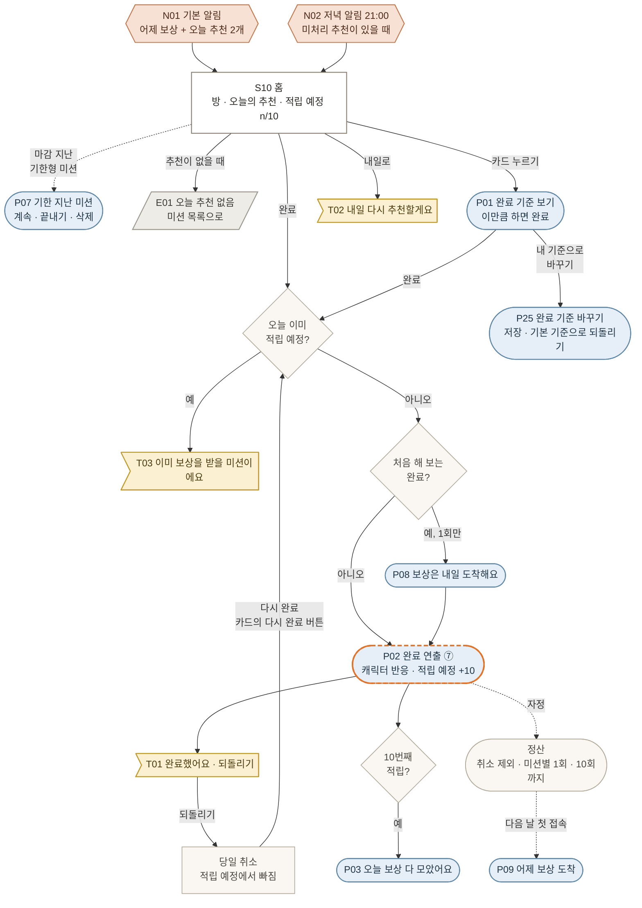
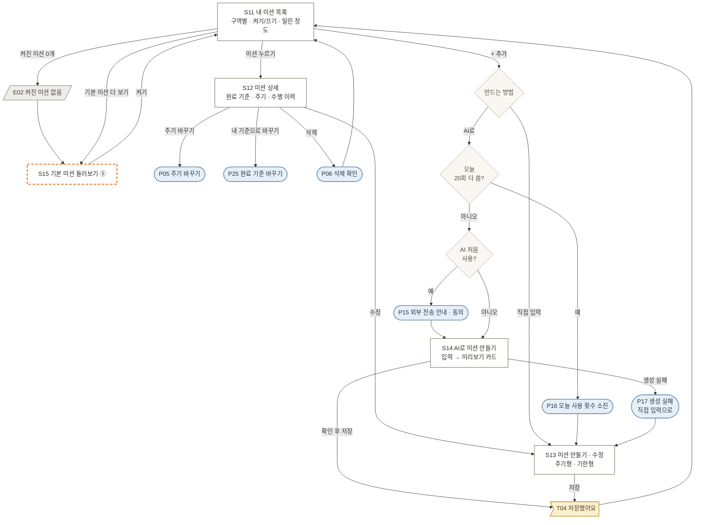
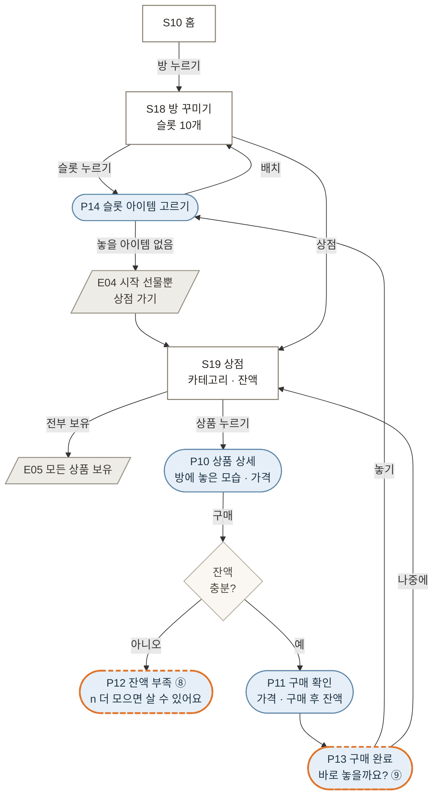
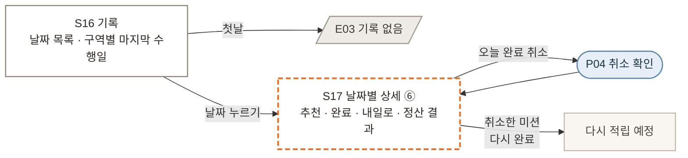
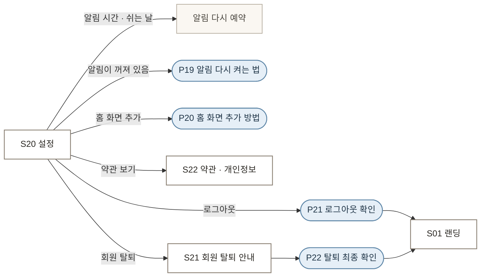

# 화면 흐름

> 2026-10-29 확정. 그림으로 보는 버전: Claude 아티팩트 「오늘챙김 화면 흐름」
> 관련 문서: [기획서](plan.md) 10장 화면 구성 · [구현 계획](implementation-plan.md) 2.3장 반응형

## 표기

| 접두 | 뜻 | 도면 모양 |
|---|---|---|
| S | 화면(페이지) | 사각형 |
| P | 팝업(다이얼로그·바텀시트·전체 화면 연출) | 둥근 캡슐 |
| T | 토스트·배너 | 깃발 |
| E | 빈 상태 | 평행사변형 |
| N | 푸시 알림 | 육각형 |
| ①~⑨ | 세부 선택 (주황 점선) | |

## 세부 선택 ①~⑨

화면을 따로 둘지 합칠지 같은 선택이다. 구현하면서 추천안을 기본으로 하고, 바꾸면 이 표를 고친다.

| 번호 | 대상 | 선택지 | 기본(추천) |
|---|---|---|---|
| ① | S03 환영 소개 | 넣기 / 빼기 | 빼고 S04에 한 줄 소개 |
| ② | S06 켜질 미션 확인 | 따로 / S05에 합치기 | S05에 합치기 |
| ③ | S08 홈 화면 추가·알림 허용 | 온보딩 중 / 첫 완료 직후 | 첫 완료 직후 |
| ④ | 탭 구성 | 5개 / 설정을 홈 상단으로 빼고 4개 | 4개 |
| ⑤ | S15 기본 미션 둘러보기 | 별도 화면 / S11 안의 탭 | S11 탭 |
| ⑥ | S17 날짜별 상세 | 별도 화면 / S16에서 펼치기 | 펼치기 |
| ⑦ | P02 완료 연출 | 팝업 / 카드 위 짧은 애니메이션 + 토스트 | 가볍게 |
| ⑧ | P12 잔액 부족 | 팝업 / P10 안 비활성 버튼 + 안내 | 비활성 버튼 |
| ⑨ | P13 구매 직후 | 바로 놓을지 묻기 / 상점에 머물기 | 묻기 |

## 1. 진입과 온보딩

앱을 열었을 때 로그인 여부, 첫 가입 여부, 전날 정산 결과에 따라 갈린다. 로그인은 소셜 로그인만 쓰고 MVP는 구글 하나다. iOS는 홈 화면에 추가해야 푸시를 받을 수 있어서 P20이 알림 허용보다 먼저다.

## 2. 탭 구조

넓은 화면(840px 이상, 폴드 펼침)에서는 하단 탭바 대신 왼쪽 세로 메뉴를 쓴다.

## 3. 하루 흐름 (홈에서 미션 수행)

알림으로 들어와 완료하고, 자정에 정산된 보상을 다음 날 받는다. 21:00에는 아직 처리하지 않은 추천이 있을 때만 저녁 알림(N02)을 보낸다. 홈에서의 취소는 T01 되돌리기로, 확인 팝업 P04는 기록 화면에서만 쓴다. 취소한 미션은 같은 날 카드의 "다시 완료" 버튼으로 다시 완료할 수 있다.

## 4. 미션 관리와 AI로 만들기

AI가 실패하거나 하루 20회를 다 쓰면 직접 입력(S13)으로 넘어간다. AI 결과는 미리보기에서 고친 뒤 저장한다.

## 5. 방과 상점

산 아이템은 슬롯에 놓아야 방에 보인다. 상품 상세에서 방에 놓은 모습을 먼저 보여준다.

## 6. 기록

완료 취소는 오늘 날짜만 가능하고, 취소한 미션은 같은 날 다시 완료할 수 있다.

## 7. 설정과 계정

알림·쉬는 날을 바꾸면 그 자리에서 알림 예약을 다시 한다. 탈퇴는 즉시 비활성화, 30일 뒤 식별정보 파기(기획서 17.3).

## 어디서든 나타나는 것

| ID | 무엇 | 언제 | 이어지는 곳 |
|---|---|---|---|
| T07 | 알림 꺼짐 배너 | 알림을 설정하지 않은 사용자의 홈 상단 | P18 → 브라우저 권한 |
| T08 | 홈 화면 추가 배너 | iOS에서 홈 화면 추가 전인 사용자의 홈 상단 | P20 |
| T05 | 오프라인 배너 | 연결이 끊겼을 때 | 계속 끊겨 있으면 S23 |
| T06 | 새 버전 · 새로고침 | 새 배포를 감지했을 때 | 새로고침 |
| P23 | 로그인 만료 | 세션이 끝났을 때 | S01 |
| P24 | 오류 · 다시 시도 | 다시 시도하면 되는 오류 | 원래 화면 |
| S24 | 404 · 오류 화면 | 없는 주소, 복구할 수 없는 오류 | 홈 |

## ID 색인

- **화면**: S01 랜딩 · S02 약관 동의 · S03 환영 소개 · S04 캐릭터 고르기 · S05 생활 정보 · S06 켜질 미션 확인 · S07 알림 시간·쉬는 날 · S08 홈 화면 추가·알림 허용 · S09 시작 선물 · S10 홈 · S11 내 미션 목록 · S12 미션 상세 · S13 미션 만들기·수정 · S14 AI로 미션 만들기 · S15 기본 미션 둘러보기 · S16 기록 · S17 날짜별 기록 상세 · S18 방 꾸미기 · S19 상점 · S20 설정 · S21 회원 탈퇴 · S22 약관·개인정보처리방침 · S23 오프라인 · S24 404·오류
- **팝업**: P01 완료 기준 보기 · P02 완료 연출 · P03 오늘 보상 다 모음 · P04 완료 취소 확인 · P05 주기 바꾸기 · P06 미션 삭제 확인 · P07 기한 지난 미션 · P08 정산 방식 안내 · P09 어제 보상 도착 · P10 상품 상세 · P11 구매 확인 · P12 잔액 부족 · P13 구매 완료 · P14 슬롯 아이템 고르기 · P15 AI 외부 전송 안내 · P16 AI 사용 횟수 소진 · P17 AI 생성 실패 · P18 알림 허용 사전 안내 · P19 알림 거부 안내 · P20 홈 화면 추가 방법 · P21 로그아웃 확인 · P22 탈퇴 최종 확인 · P23 로그인 만료 · P24 오류 · P25 완료 기준 바꾸기
- **토스트·배너**: T01 완료·되돌리기 · T02 내일 다시 추천 · T03 이미 적립 예정 · T04 저장 완료 · T05 오프라인 · T06 새 버전 · T07 알림 꺼짐 · T08 홈 화면 추가
- **빈 상태**: E01 오늘 추천 없음 · E02 켜진 미션 없음 · E03 기록 없음 · E04 놓을 아이템 없음 · E05 모든 상품 보유
- **푸시**: N01 기본 알림 · N02 저녁 알림 (21:00)
